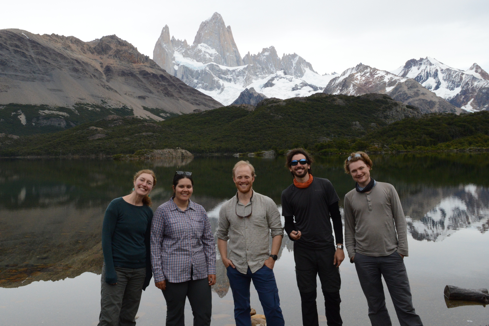
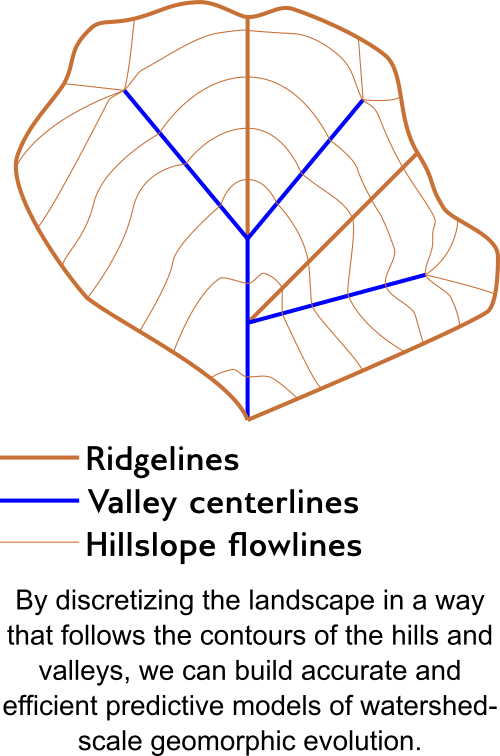
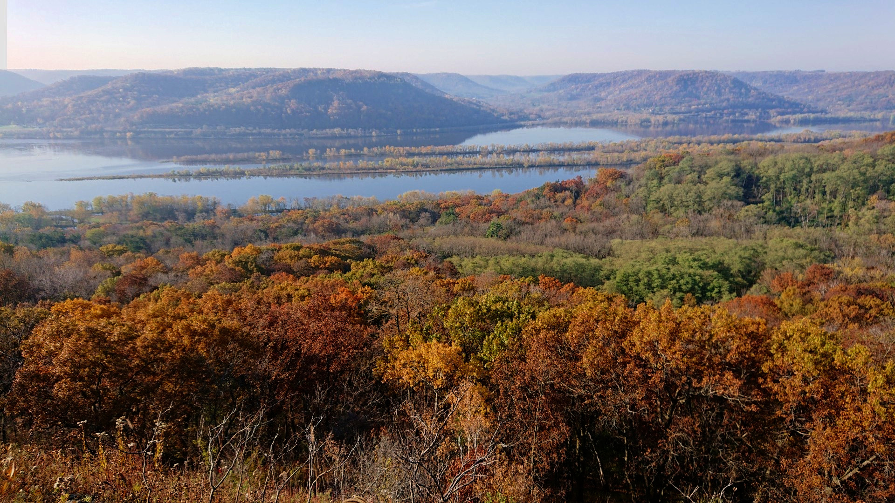
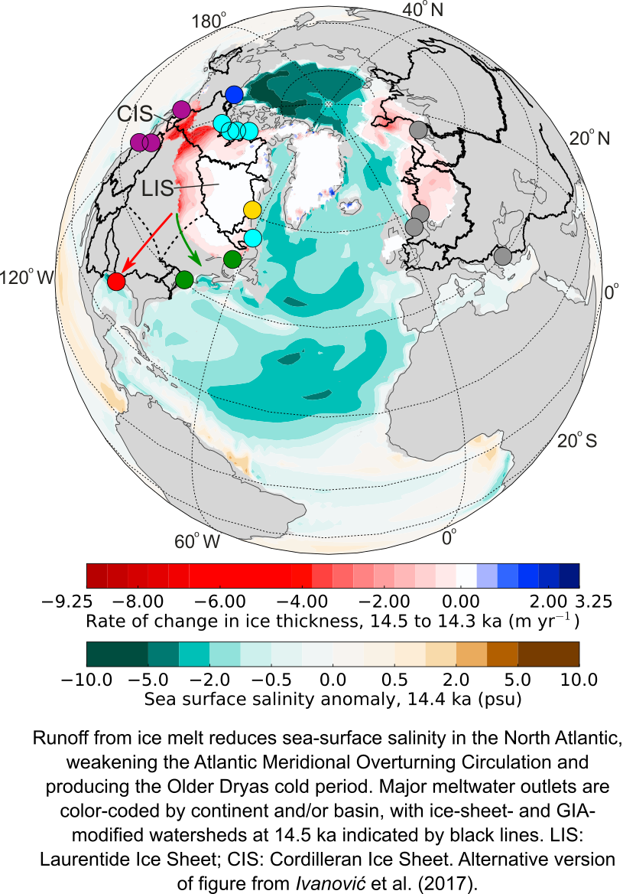
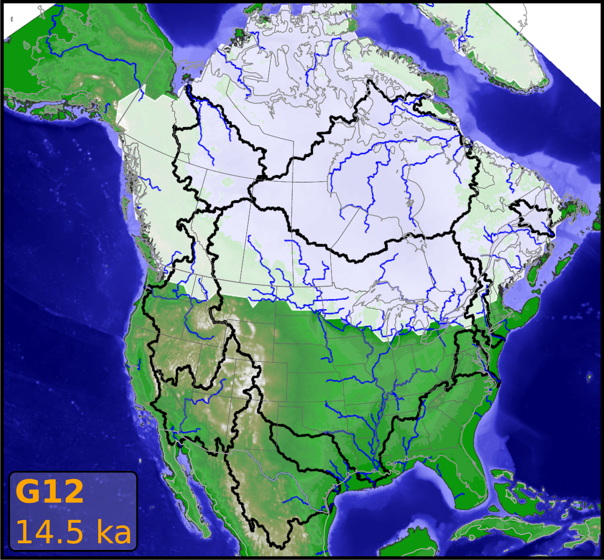
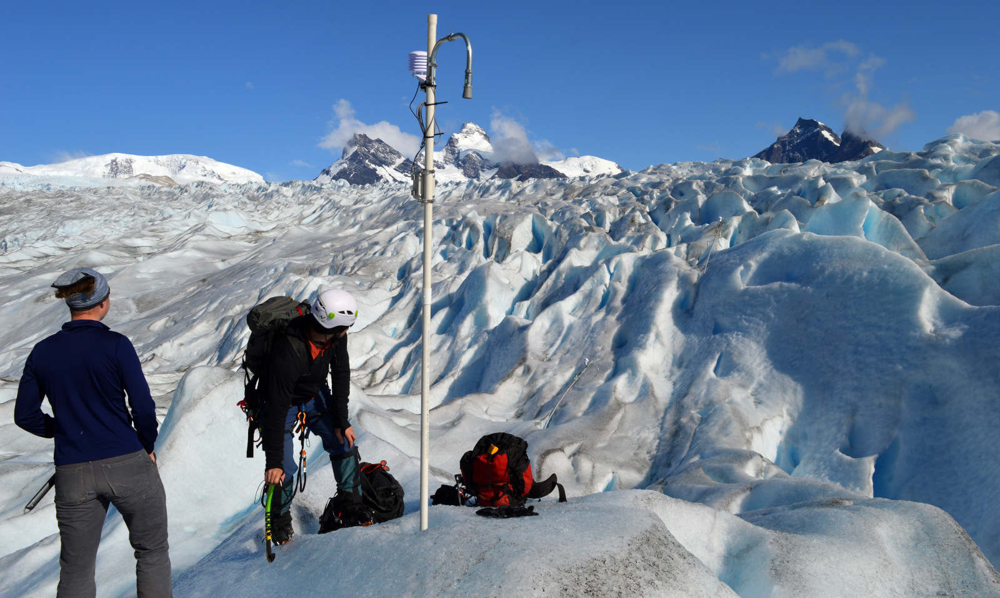
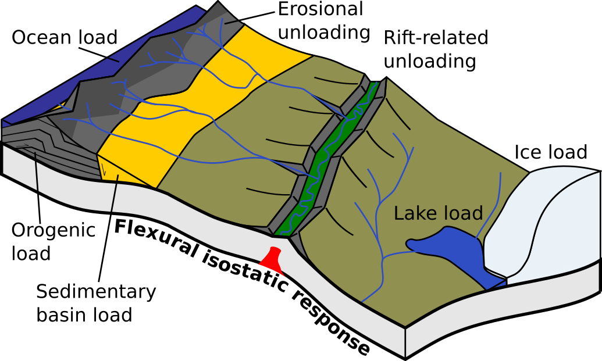

# Research

Our work connects glaciers to the sea, encompassing water, sediment, and landscape evolution. Our diverse work, from building embedded electronics to augering for samples from past rivers and glaciers, is designed to be able to answer one key question: ***What drives and sets the pace and style of Earth-surface change?***

To see our open-source code, open-access data, and open-source hardware designs, visit:
* [Research group GitHub organization](https://github.com/umn-earth-surface)
* [Wickert's GitHub](https://github.com/awickert)
* Instrumentation GitHub organizations for [finalized](https://github.com/NorthernWidget) and [experimental](https://github.com/NorthernWidget-Skunkworks) designs

## River mechanics and geomorphic evolution

We work to find **physics-centered solutions** for how **river channels and watersheds evolve through time**. Our goal is geomorphic: to predict the results of landscape change. To do so, we develop theory and build mathematical and numerical models. We then test these against field data from modern and ancient settings, as well as against laboratory experiments, to improve our ability to predict both natural and human impacts on river and landscape change.

Current focal points include:
* Coupled evolution of channel long profiles and hydraulic geometry
* Linking hydrology and hillslope sediment supply with channel evolution
* Impacts of changing climate and land use on river systems
* Transience and departures from steady bankfull hydraulics

### Key Personnel

* Andy Wickert
* Nilay Iscen
* Jabari Jones
* Shanti Penprase
* Phil Larson
* Peter Mitchell

### Key Publications

* Ruby, A., F. McNab, T. F. Schildgen, A. D. Wickert, and V. M. Fernandes (2026), How sediment supply, sea-level and glacial isostatic oscillations drive alluvial river long-profile evolution and terrace formation, AGU Advances, 7(1), e2025AV002035, [doi:10.1029/2025AV002035](https://doi.org/10.1029/2025AV002035).
* Fernandes, V. M., A. Ruby, F. McNab, H. Wittmann, A. D. Wickert, L. Grimm, and T. Schildgen (2026), Mantle-driven, climatically modulated landscape evolution in Southern Patagonia, Geology, 54(2), 117–122, [doi:10.1130/G53764.1](https://doi.org/10.1130/G53764.1).
* Wood, J. J., A. D. Wickert, P. H. Larson, and L. Svien (2026), A 140-year record of stream and valley sedimentation in the Whitewater River Valley, Minnesota, United States, Scientific Data, 13, 1375, [doi:10.1038/s41597-026-07866-0](https://doi.org/10.1038/s41597-026-07866-0).
* McNab, F., T. F. Schildgen, J. M. Turowski, and A. D. Wickert (2025), Influence of network geometry on long-term morphodynamics of alluvial rivers, Earth Surface Dynamics, 13(5), 1059–1092, [doi:10.5194/esurf-13-1059-2025](https://doi.org/10.5194/esurf-13-1059-2025).
* Penprase, S. B., A. D. Wickert, P. H. Larson, J. J. Wood, I. J. Larsen, and T. M. Rittenour (2025), Plow versus Ice Age: Erosion rate variability from glacial–interglacial climate change is an order of magnitude lower than agricultural erosion in the Upper Mississippi River Valley, USA, Geology, 53(6), 535–539, [doi:10.1130/G52585.1](https://doi.org/10.1130/G52585.1).
* McNab, F., T. F. Schildgen, J. M. Turowski, and A. D. Wickert (2023), Diverse responses of alluvial rivers to periodic environmental change, Geophysical Research Letters, 50(10), e2023GL103075, [doi:10.1029/2023GL103075](https://doi.org/10.1029/2023GL103075).
* Beaulieu, O. P., L. D. Witte, and A. D. Wickert (2021), [Mechanistic insights from emergent landslides in physical experiments](https://pubs.geoscienceworld.org/gsa/geology/article/49/4/392/593340/Mechanistic-insights-from-emergent-landslides-in), Geology, 49(4), 392–396, doi:10.1130/G47875.1.
* Larson, P.H., Dorn, R.I., Skotnicki, S., Seong, Y.B., DePonty, J. (2020), [Impact of drainage integration on basin geomorphology and landform evolution: Case study along the Salt and Verde Rivers of the Sonoran Desert, USA](https://doi.org/10.1016/j.geomorph.2020.107439), Geomorphology, doi:10.1016/j.geomorph.2020.107439.
* Skotnicki, S., Seong, Y.B., Dorn, R.I., Larson, P.H., Deponty, J. (2020). [Drainage integration of the Salt and Verde Rivers in a Basin and Range extensional landscape, central Arizona, USA](https://doi.org/10.1016/j.geomorph.2020.107512), Geomorphology, doi:10.1016/j.geomorph.2020.107512
* Savi, S., S. Tofelde, A. D. Wickert, A. Bufe, T. F. Schildgen, and M. R. Strecker (2020), [Interactions between main channels and tributary alluvial fans: channel adjustments and sediment-signal propagation](https://esurf.copernicus.org/articles/8/303/2020/), Earth Surface Dynamics, 8, 303–322, doi:10.5194/esurf-8-303-2020.
* Bufe, A., J. M. Turowski, D. W. Burbank, C. Paola, A. D. Wickert, and S. Tofelde (2019), [Controls on the lateral channel migration rate of braided channel systems in coarse non-cohesive sediment](https://onlinelibrary.wiley.com/doi/full/10.1002/esp.4710), Earth Surface Processes and Landforms, 44(14), 2823–2836, doi:10.1002/esp.4710.
* Tofelde, S., S. Savi, A. D. Wickert, T. F. Schildgen, and A. Bufe (2019), [Alluvial channel response to environmental perturbations: Fill-terrace formation and sediment-signal disruption](https://esurf.copernicus.org/articles/7/609/2019/), Earth Surface Dynamics, 7(2), 609–630, doi:10.5194/esurf-7-609-2019.
* Wickert, A. D., and T. F. Schildgen (2019), [Long-Profile Evolution of Transport-Limited Gravel-Bed Rivers](https://esurf.copernicus.org/articles/7/17/2019/), Earth Surface Dynamics, 7, 17–43, doi:10.5194/esurf-7-17-2019.
* Donovan, M., Belmont, P., Notebaert, B., Coombs, T., Larson, P.H., Souffront, M. (2019). Accounting for uncertainty in measurements of river channel migration. Earth Science Reviews. https://doi.org/10.1016/j.earscirev.2019.04.009
* Larson, P.H., Meek, N., Dorn, R.I., Douglass, J., Seong, Y.B., (2016). How Rivers Cross Mountains. Annals of the American Association of Geographers. DOI:  10.1080/24694452.2016.1203283
* Larson, P.H., Kelley, S., Dorn, R.I., Seong Y.B. (2016). Pace of Landscape Change in the northeastern Sonoran Desert, United States. Annals of the American Association of Geographers. DOI: 10.1080/24694452.2016.1201420
* Faulkner, D., Larson, P.H., Jol, H.M., Running, G.L., Loope, H.M., and Goble, R.J. (2016). Episodic Incision and Terrace Formation Resulting from Abrupt Late-Glacial Base-Level Fall, Lower Chippewa River, Wisconsin, USA. Geomorphology. 266: 75-95.  DOI:10.1016/j.geomorph.2016.04.016
* Larson, P.H., Dorn, R.I., Faulkner, D.J, Friend, D.A. (2015). Toe-Cut Terraces: A Review and Criteria to Differentiate from Traditional Fluvial Terraces. Progress in Physical Geography. DOI: 10.1177/0309133315582045.
* Larson, P.H. and Dorn, R.I. (2014). Strath Development in Small Arid Watersheds: Case Study of South Mountain, Sonoran Desert, Arizona. American Journal of Science. 314: 1202-1223.    
* Wickert, A. D., J. M. Martin, M. Tal, W. Kim, B. A. Sheets, and C. Paola (2013), River channel lateral mobility: metrics, time scales, and controls, Journal of Geophysical Research: Earth Surface, 118(2), 396–412, doi:10.1029/2012JF002386.

### Additional Relevant Publications

* Tofelde, S., W. Düsing, T. F. Schildgen, A. D. Wickert, H. Wittmann, R. N. Alonso, and M. R. Strecker (2018), [Effects of deep-seated versus shallow hillslope processes on cosmogenic 10 Be concentrations in fluvial sand and gravel](https://onlinelibrary.wiley.com/doi/abs/10.1002/esp.4471), Earth Surface Processes and Landforms, 43, 3086–3098, doi:10.1002/esp.4471.
* Perron, J. T., P. M. Myrow, K. L. Huppert, A. R. Koss, and A. D. Wickert (2018), Ancient record of changing flows from wave ripple defects, Geology, 46(10), 875–878, doi:10.1130/G45463.1.

## Glacial cycles and global change

How did ice sheets and global sea-level change since the Last Glacial Maximum, ~26,000–19,500 years ago, and what can this teach us about past and modern landscapes, ice dynamics, climate, and the solid Earth? Our work to answer these questions encompasses:
* Field studies to map and date evidence of ancient rivers and landscapes
* Global sea level and glacial isostatic adjustment modeling
* Compilations of marine records of past water flow paths
* Models and observations of ancient lake and groundwater levels
* Collaborations to couple our work as inputs to and/or tests for general circulation models (i.e., global climate models)

We use these approaches together to reconstruct past landscapes and environments, and to test the skill of our physics-based models of river and landscape change against long-term data sets.

***Research spotlight:*** [***A buried waterfall on a backwards Mississippi River***](https://www.safl.umn.edu/node/1636)

### Key Personnel

* Kerry Callaghan
* Andy Wickert
* Phil Larson
* Max van Wyk de Vries
* Shanti Penprase
* Peter Mitchell

### Key Publications: Paleoclimate modeling

* Ivanović, R. F., L. J. Gregoire, A. Burke, A. D. Wickert, P. J. Valdes, H. C. Ng, L. F. Robinson, J. F. McManus, J. X. Mitrovica, L. Lee, and J. E. Dentith (2018b), [Acceleration of northern ice sheet melt induces AMOC slowdown and northern cooling in simulations of the early last deglaciation](https://agupubs.onlinelibrary.wiley.com/doi/abs/10.1029/2017PA003308), Paleoceanography and Paleoclimatology, 33(7), 807–824, doi:10.1029/2017PA003308.
* Ivanović, R. F., L. J. Gregoire, A. D. Wickert, and A. Burke (2018a), [Climatic effect of Antarctic meltwater overwhelmed by concurrent Northern hemispheric melt](https://agupubs.onlinelibrary.wiley.com/doi/10.1029/2018GL077623), Geophys. Res. Lett., 45(11), 5681–5689, doi:10.1029/2018GL077623.
* Ivanović, R. F., L. J. Gregoire, A. D. Wickert, P. J. Valdes, and A. Burke (2017), [Collapse of the North American ice saddle 14,500 years ago caused widespread cooling and reduced ocean overturning circulation](https://agupubs.onlinelibrary.wiley.com/doi/abs/10.1002/2016GL071849), Geophys. Res. Lett., 44(1), 383–392, doi:10.1002/2016GL071849.

### Key Publications: Rivers, Glaciers, and Ice Sheets

* Romero, M., M. Van Wyk de Vries, A. Fedotova, E. Ito, M. D. Shapley, M. B. Magnani, A. D. Wickert, A. G. Jones, S. A. Marcott, J. A. Strelin, G. Brignone, S. B. Penprase, and M. W. Caffee (2026), Late Holocene history of Glaciar Upsala, southern Patagonia, constrained by terrestrial and lacustrine records, Quaternary Science Reviews, 388, 110093, [doi:10.1016/j.quascirev.2026.110093](https://doi.org/10.1016/j.quascirev.2026.110093).
* Romero, M., S. B. Penprase, M. S. Van Wyk de Vries, A. D. Wickert, A. G. Jones, S. A. Marcott, J. A. Strelin, M. A. Martini, T. Rittenour, G. Brignone, M. D. Shapley, E. Ito, K. R. MacGregor, and M. W. Caffee (2024), Late Quaternary glacial maxima in Southern Patagonia: insights from the Lago Argentino glacier lobe, Climate of the Past, 20(8), 1861–1883, [doi:10.5194/cp-20-1861-2024](https://doi.org/10.5194/cp-20-1861-2024).
* Van Wyk de Vries, M., M. Romero, S. B. Penprase, G.-H. C. Ng, and A. D. Wickert (2023), Increasing rate of 21st century volume loss of the Patagonian Icefields measured from proglacial river discharge, Journal of Glaciology, 69(277), 1187–1202, [doi:10.1017/jog.2023.9](https://doi.org/10.1017/jog.2023.9).
* Wickert, A. D., C. Williams, L. J. Gregoire, K. L. Callaghan, R. F. Ivanović, P. J. Valdes, L. Vetter, and C. E. Jennings (2023), Marine-calibrated chronology of southern Laurentide Ice Sheet advance and retreat: ~2000-year cycles paced by meltwater–climate feedback, Geophysical Research Letters, 50(10), e2022GL100391, [doi:10.1029/2022GL100391](https://doi.org/10.1029/2022GL100391).
* Austermann, J., A. D. Wickert, T. Pico, J. Kingslake, K. L. Callaghan, and R. C. Creel (2022), Glacial isostatic adjustment shapes proglacial lakes over glacial cycles, Geophysical Research Letters, 49(24), e2022GL101191, [doi:10.1029/2022GL101191](https://doi.org/10.1029/2022GL101191).
* Van Wyk de Vries, M., E. Ito, M. Shapley, G. Brignone, M. Romero, A. D. Wickert, L. H. Miller, and K. R. MacGregor (2022), Physical limnology and sediment dynamics of Lago Argentino, the world’s largest ice-contact lake, Journal of Geophysical Research: Earth Surface, 127(3), e2022JF006598, [doi:10.1029/2022JF006598](https://doi.org/10.1029/2022JF006598).
* Van Wyk de Vries, M., A. D. Wickert, K. R. MacGregor, C. Rada, and M. J. Willis (2022), Atypical landslide induces speedup, advance, and long-term slowdown of a tidewater glacier, Geology, 50(7), [doi:10.1130/G49854.1](https://doi.org/10.1130/G49854.1).
* Van Wyk de Vries, M., P. D. Carchipulla Morales, A. D. Wickert, and V. G. Minaya (2022), Glacier thickness and ice volume of the Northern Andes, Scientific Data, 9, 342, [doi:10.1038/s41597-022-01446-8](https://doi.org/10.1038/s41597-022-01446-8).
* Naylor, S., A. D. Wickert, D. A. Edmonds, and B. J. Yanites (2021), Landscape evolution under the southern Laurentide Ice Sheet, Science Advances, 7(48), eabj2938, [doi:10.1126/sciadv.abj2938](https://doi.org/10.1126/sciadv.abj2938).
* Van Wyk de Vries, M., and A. D. Wickert (2021), Glacier Image Velocimetry: An open-source toolbox for easy and rapid calculation of high-resolution glacier-velocity fields, The Cryosphere, 15, 2115–2132, [doi:10.5194/tc-15-2115-2021](https://doi.org/10.5194/tc-15-2115-2021).
* Koriche, S. A., J. S. Singarayer, H. L. Cloke, P. J. Valdes, F. P. Wesselingh, S. B. Kroonenberg, A. D. Wickert, and T. A. Yanina (2022), What are the drivers of Caspian Sea level variation during the late Quaternary?, Quaternary Science Reviews, 283, 107457, [doi:10.1016/j.quascirev.2022.107457](https://doi.org/10.1016/j.quascirev.2022.107457).
* Tofelde, S., T. F. Schildgen, S. Savi, H. Pingel, A. D. Wickert, B. Bookhagen, H. Wittmann, R. N. Alonso, J. Cottle, and M. R. Strecker (2017), [100 kyr fluvial cut-and-fill terrace cycles since the Middle Pleistocene in the southern Central Andes, NW Argentina](https://www.sciencedirect.com/science/article/pii/S0012821X17303102), Earth Planet. Sci. Lett., 473, 141–153, doi:10.1016/j.epsl.2017.06.001.
* Wickert, A. D., R. S. Anderson, J. X. Mitrovica, S. Naylor and E. C. Carson (2019a), [The Mississippi River records glacial-isostatic deformation of North America](https://advances.sciencemag.org/content/5/1/eaav2366), Science Advances, 5(1), eaav2366, doi:10.1126/sciadv.aav2366.
* Wickert, A. D. (2016b), [Reconstruction of North American drainage basins and river discharge since the Last Glacial Maximum](https://esurf.copernicus.org/articles/4/831/2016/), Earth Surface Dynamics, 4(4), 831–869, doi:10.5194/esurf-4-831-2016.
* Faulkner, D., Larson, P.H., Jol, H.M., Running, G.L., Loope, H.M., and Goble, R.J. (2016). Episodic Incision and Terrace Formation Resulting from Abrupt Late-Glacial Base-Level Fall, Lower Chippewa River, Wisconsin, USA. Geomorphology. 266: 75-95.  DOI:10.1016/j.geomorph.2016.04.016
* Wickert, A. D., J. X. Mitrovica, C. Williams, and R. S. Anderson (2013), [Gradual demise of a thin southern Laurentide ice sheet recorded by Mississippi drainage](https://www.nature.com/articles/nature12609), Nature, 502(7473), pp. 668–671, doi:10.1038/nature12609.

### Additional Relevant Publications

* Monteleone, K., E. J. Dixon, and A. D. Wickert (2013), [Lost Worlds: A predictive model to locate submerged archaeological sites in SE Alaska, USA](https://www.researchgate.net/publication/271212907_Lost_Worlds_A_predictive_model_to_locate_submerged_archaeological_sites_in_SE_Alaska_USA), in Archaeology in the Digital Era: Volume II. e-Papers from the 40th Conference on Computer Applications and Quantitative Methods in Archaeology, Southampton, 26-29 March 2012, edited by G. Earl, T. Sly, A. Chrysanthi, P. Murrieta-Flores, C. Papadopoulos, I. Romanowska, and D. Wheatley, pp. 678–693, Amsterdam University Press, ISBN:9789089646637.

## Water in the landscape

### Topographic depressions and flow routing

Internally-drained regions in digital elevation models, termed "depressions", have been traditionally treated as artifacts that need to be removed. While sometimes this was the case, many depressions are real. Unfortunately, these algorithms that erased depressions forced hydrologic and geomorphic models to also ignore them. This technological deficiency fueled a paradigm in which hydrologists and geomorphologists focused on steep mountain catchments rather than low-relief catchments with lakes and swales.

The Depression Hierarchy and Fill-Spill-Merge algorithms and associated code bases (https://github.com/r-barnes/Barnes2019-DepressionHierarchy; https://github.com/r-barnes/Barnes2020-FillSpillMerge) are poised to reverse this trend. They allow us to integrate closed depressions directly into drainage networks in a mathematically consistent way as part of a directed graph. This tool will allow models to incorporate more elements of reality and open new landscapes and environments to cutting-edge hydrological and geomorphic research.

### Hydrological modeling, water resources, and sustainability

* We co-built [GSFLOW-GRASS](https://github.com/UMN-Hydro/GSFLOW-GRASS), which automates construction of model domains and inputs to the [US Geological Survey's integrated hydrological model GSFLOW](https://www.usgs.gov/software/coupled-ground-water-and-surface-water-flow-model-gsflow), a combination of MODFLOW and PRMS.
* Changing climate, land use, and land cover is changing hydrological regimes across the Midwest. We seek to quantify and attribute this change.
* We frequently apply our instrumentation to water-resources problems.

### Key Personnel

* Richard Barnes
* Kerry Callaghan
* Jabari Jones
* Andy Wickert

### Key Publications

* Callaghan, K. L., A. D. Wickert, R. Barnes, and J. Austermann (2025), The Water Table Model (WTM) v2.0.1: Coupled groundwater and dynamic lake modelling, Geoscientific Model Development, 18(5), 1463–1486, [doi:10.5194/gmd-18-1463-2025](https://doi.org/10.5194/gmd-18-1463-2025).
* Barnes, R., K. L. Callaghan, and A. D. Wickert (2021), Computing water flow through complex landscapes – Part 3: Fill-Spill-Merge: Flow routing in depression hierarchies, Earth Surface Dynamics, 9, 105–121, [doi:10.5194/esurf-9-105-2021](https://doi.org/10.5194/esurf-9-105-2021).
* Barnes, R., K. L. Callaghan, and A. D. Wickert (2020a), [Computing water flow through complex landscapes, Part 2: Finding hierarchies in depressions and morphological segmentations](https://esurf.copernicus.org/articles/8/431/2020/), Earth Surface Dynamics, 8, 431–445, doi:10.5194/esurf-8-431-2020.
* Callaghan, K. L., and A. D. Wickert (2019), [Computing water flow through complex landscapes – Part 1: Incorporating depressions in flow routing using FlowFill](https://esurf.copernicus.org/articles/7/737/2019/), Earth Surface Dynamics, 7, 737–753, doi:10.5194/esurf-7-737-2019.
* Somers, L. D., J. M. McKenzie, B. G. Mark, P. Lagos, G.-H. C. Ng, A. D. Wickert, C. Yarleque, M. Baraër, and Y. Silva (2019), [Groundwater buffers decreasing glacier melt in the Andes – but not forever](https://agupubs.onlinelibrary.wiley.com/doi/abs/10.1029/2019GL084730), Geophysical Research Letters, 46(22), 13016–13026, doi:10.1029/2019GL084730.
* Saberi, L., R. T. McLaughlin, G.-H. C. Ng, J. La Frenierre, A. D. Wickert, M. Baraer, W. Zhi, L. Li, and B. G. Mark (2019), [Multi-scale temporal variability in meltwater contributions in a tropical glacierized watershed](https://hess.copernicus.org/articles/23/405/2019/), Hydrology and Earth System Sciences, 23(1), 405–425, doi:10.5194/hess-23-405-2019.
* Ng, G.-H. C., A. D. Wickert, L. D. Somers, L. Saberi, C. Cronkite-Ratcliff, R. G. Niswonger, and J. M. McKenzie (2018), [GSFLOW-GRASS v1.0.0: GIS-enabled hydrologic modeling of coupled groundwater–surface-water systems](https://gmd.copernicus.org/articles/11/4755/2018/), Geoscientific Model Development, 11, 4755–4777, doi:10.5194/gmd-11-4755-2018.
* Pelletier, J. D., A. B. Murray, J. L. Pierce, P R. Bierman, D. D. Breshears, B. T. Crosby, M. Ellis, E. Foufoula-Georgiou, A. M. Heimsath, C. Houser, N. Lancaster, M. Marani, D. J. Merritts, L. J. Moore, J. L. Pederson, M. J. Poulos, T. M. Rittenour, J. C. Rowland, P Ruggiero, D. J. Ward, K. X. Whipple, A. D. Wickert, and E. M. Yager (2015), [Forecasting the response of Earth’s surface to future climatic and land-use changes: A review of methods and research needs](https://agupubs.onlinelibrary.wiley.com/doi/full/10.1002/2014EF000290), Earth’s Future, 3(7), 220–251, doi:10.1002/2014EF000290.

## Flexural isostasy

Wickert developed [gFlex](https://github.com/awickert/gFlex), a finite-difference solver for lithospheric flexure that is written in Python and integrated into [CSDMS](https://csdms.colorado.edu/), [Landlab](https://landlab.github.io/), and [PyBandlands](https://github.com/badlands-model/badlands). We also occasionally use it ourselves, thus far on glacial isostatic adjustment and foreland basin development.

### Key Publications
* Anderson, L. S., Á. Geirsdóttir, G. E. Flowers, A. D. Wickert, G. Aðalgeirsdóttir, and Þ. Þorsteinsson (2019), [Controls on the lifespans of Icelandic ice caps](https://www.sciencedirect.com/science/article/pii/S0012821X19304728#:~:text=Anthropogenic%20warming%20is%20expected%20to,of%20glacier%20lifespans%20in%20Iceland.), Earth and Planetary Science Letters, 527, 115780, doi:10.1016/j.epsl.2019.115780.
* Ballato, P., F. Cifelli, G. Heidarzadeh, M. Ghassemi, A. Wickert, J. Hassanzadeh, G. Dupont-Nivet, P. Balling, M. Sudo, G. Zeilinger, A. Schmitt, M. Mattei, M. Strecker (2017), [Tectono-sedimentary evolution of the northern Iranian Plateau: insights from middle-late Miocene foreland-basin deposits](https://onlinelibrary.wiley.com/doi/abs/10.1111/bre.12180), Basin Research, 29(4), 417–446, doi:10.1111/bre.12180.
* Mey, J., D. Scherler, A. D. Wickert, D. L. Egholm, M. Tesauro, T. F. Schildgen, and M. R. Strecker (2016), [Glacial isostatic uplift of the European Alps, Nature Communications](https://www.nature.com/articles/ncomms13382), 7, 13382, doi:10.1038/ncomms13382.
* Wickert, A. D. (2016a), [Open-source modular solutions for flexural isostasy: gFlex v1.0](https://www.geoscientific-model-development.net/9/997/2016/), Geoscientific Model Development, 9(3). pp. 997–1017, doi:10.5194/gmd-9-997-2016.

### Key Personnel
* Andy Wickert
* Max van Wyk de Vries

## Instrumentation

We design and build open-source sensors and data loggers to monitor the environment. For more information, see:
* [Northern Widget Website](https://northernwidget.com/): information on our open-source electronics
* [Northern Widget GitHub](https://github.com/NorthernWidget)
* [Northern Widget Skunkworks GitHub](https://github.com/NorthernWidget-Skunkworks)

### Key Personnel

* Bobby Schulz
* Andy Wickert

### Key Publications

* Moodie, A. J., E. A. Barefoot, E. Hutton, C. T. Nguyen, A. D. Wickert, and J. Marr (2026), Short Communication: The need for open-source hardware, software, and data-sharing specifications in geomorphology, Earth Surface Dynamics, 14(1), 85–94, [doi:10.5194/esurf-14-85-2026](https://doi.org/10.5194/esurf-14-85-2026).
* Chen, X., B. Schulz, I. Davitt-Liu, A. D. Wickert, and X. Feng (2025), A Compact, Low-Cost Sensing System to Enable Distributed Measurements of Urban Tree Transpiration, Journal of Geophysical Research: Biogeosciences, 130(5), e2024JG008653, [doi:10.1029/2024JG008653](https://doi.org/10.1029/2024JG008653).
* Wickert, A. D., K. R. Barnhart, W. H. Armstrong, M. Romero, B. Schulz, G.-H. C. Ng, C. T. Sandell, J. La Frenierre, S. B. Penprase, M. Van Wyk de Vries, and K. R. MacGregor (2023), Automated Ablation Stakes to Constrain Temperature-index Melt Models, Annals of Glaciology, 64(92), 425–438, [doi:10.1017/aog.2024.21](https://doi.org/10.1017/aog.2024.21).
* Wickert, A. D., C. T. Sandell, R. Schulz, and G.-H. C. Ng (2019b), [Open-source Arduino-compatible data loggers designed for field research](https://hess.copernicus.org/articles/23/2065/2019/), Hydrology and Earth System Sciences, 23, 2065–2076, doi:10.5194/hess-23-2065-2019.
* Tauro, F., Selker, J., van de Giesen, N., Abrate, T., Uijlenhoet, R., Porfiri, M., Manfreda, S., Caylor, K., Moramarco, T., Benveniste, J., Ciraolo, G., Estes, L., Domeneghetti, A., Perks, M., Corbari, C., Rabiei, E., Ravazzani, G., Bogena, H., Harfouche, A., Brocca, L., Maltese, A., Wickert, A., Tarpanelli, A., Good, S., Lopez Alcala, J. M., Petroselli, A., Cudennec, C., Blume, T., Hut, R., and Grimaldi, S. (2018), [Measurements and Observations in the XXI century (MOXXI): innovation and multidisciplinarity to sense the hydrological cycle](https://www.tandfonline.com/doi/abs/10.1080/02626667.2017.1420191), Hydrological Sciences Journal, 63(2), 169–196, doi:10.1080/02626667.2017.1420191.
* Wickert, A. D. (2014), [The ALog: Inexpensive, Open-Source, Automated Data Collection in the Field](https://esajournals.onlinelibrary.wiley.com/doi/full/10.1890/0012-9623-95.2.68#:~:text=The%20ALog%20data%20logger%2C%20built,%2C%20and%20low%E2%80%90cost%20design.), Bulletin of the Ecological Society of America, 95(2), 68–78, doi:10.1890/0012-9623-95.2.68.
